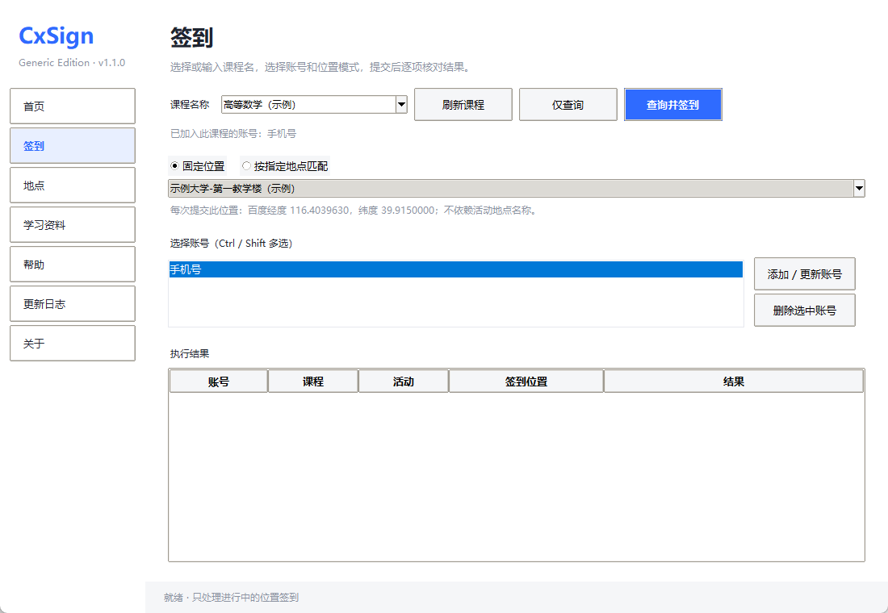
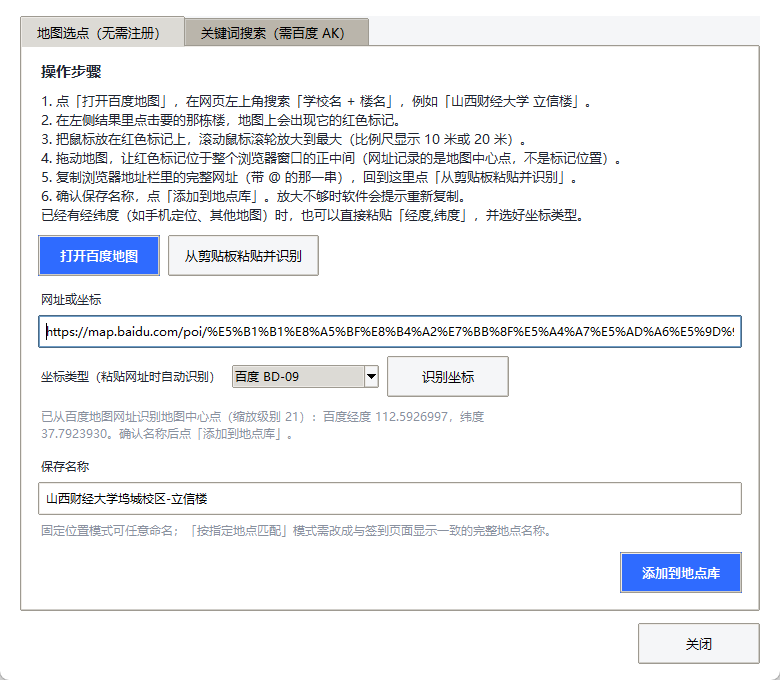
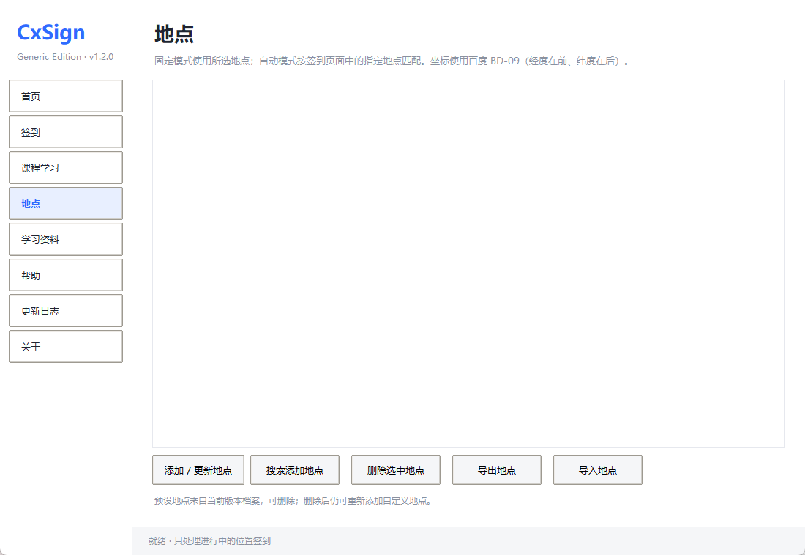
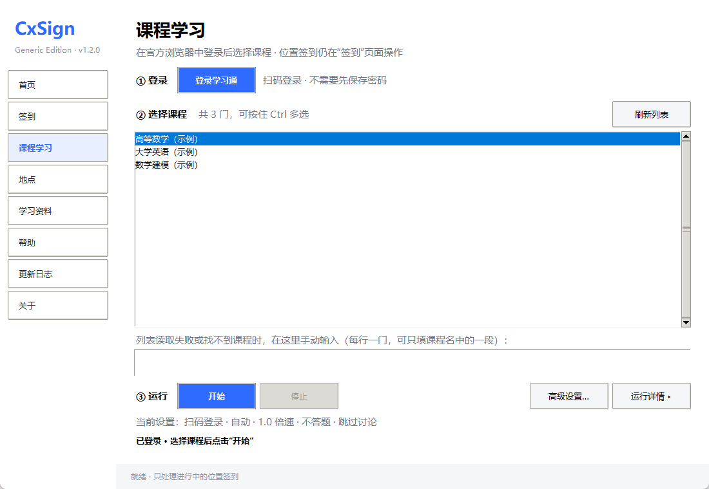
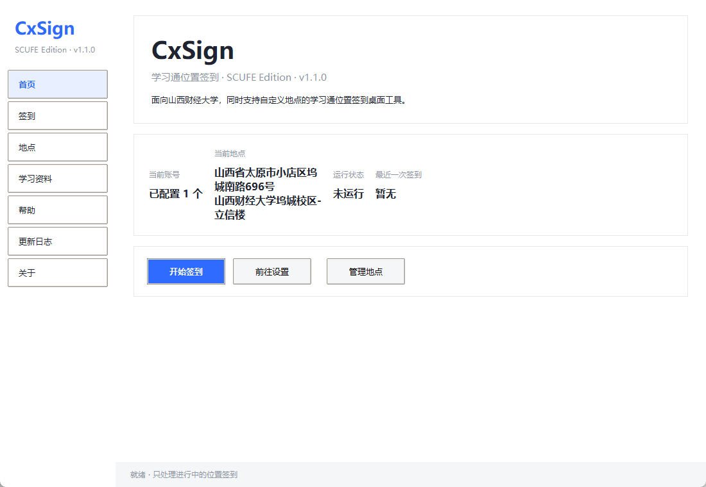
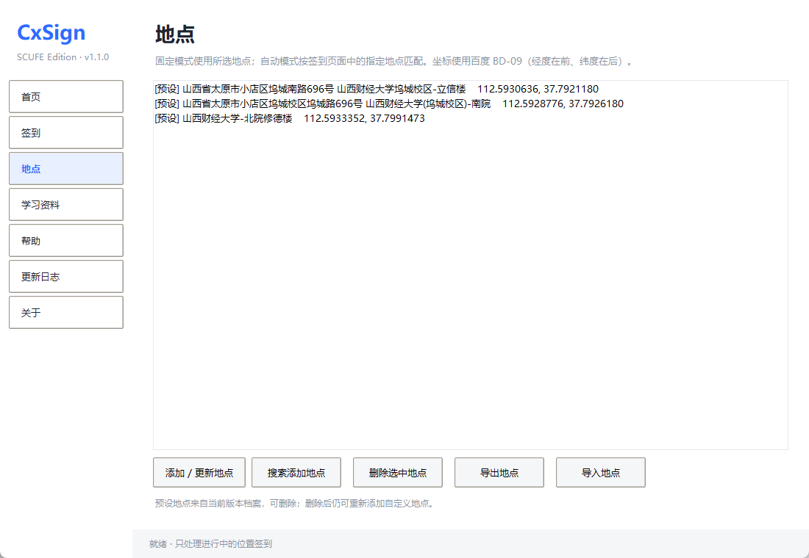
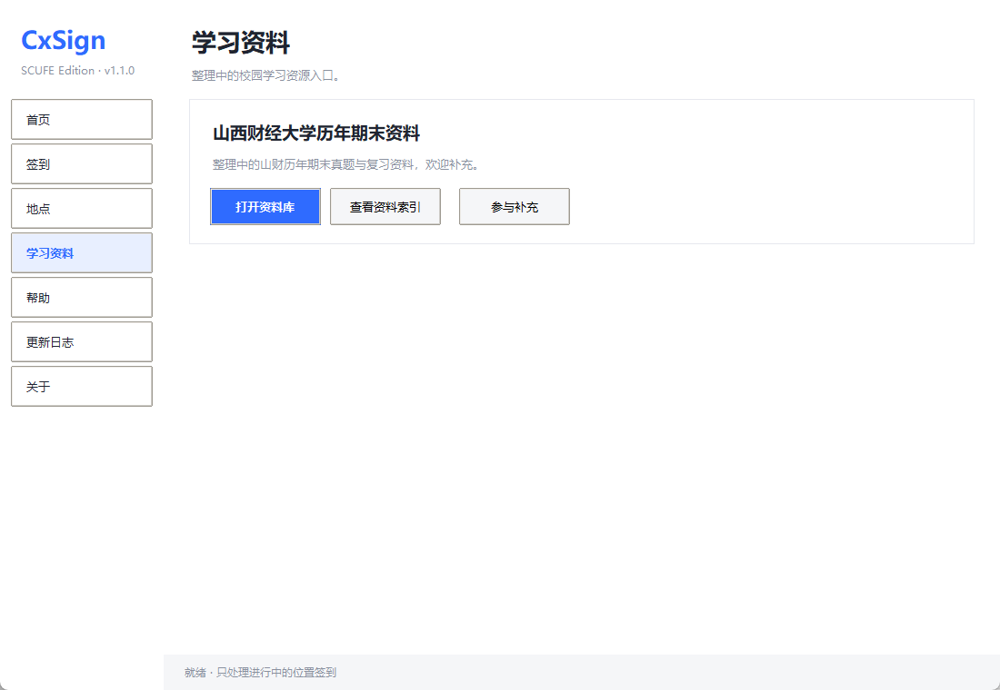

<div align="center">

# CxSign · 学习通位置签到桌面工具

**选好账号、课程和地点，点一下，完成学习通（超星）进行中的位置签到，并逐个账号核对结果。**

[](https://github.com/Xiaotian69/CampusSign/releases/latest)


[](LICENSE)

[⬇️ 下载通用版](https://github.com/Xiaotian69/CampusSign/releases/download/v1.2.0/CxSign-v1.2.0-Generic.zip) · [使用教程](docs/USER_GUIDE.md) · [隐私说明](docs/PRIVACY.md) · [常见问题](#常见问题) · [English](#english-summary)

</div>



<sub>截图使用占位账号、示例课程与示例地点，不含任何真实数据。</sub>

CxSign 是一个 Windows 图形界面工具，核心功能是**学习通位置签到**。不需要命令行，也不需要手动查经纬度：添加账号，刷新课程，选择地点，点击「查询并签到」，结果按账号逐行列出。适用于任何学校，山西财经大学同学可以使用内置地点的 [SCUFE Edition](#高校预设--scufe-edition)。

v1.2.0 新增可选的 **[课程学习](#课程学习可选v120-新增)**：在官方浏览器扫码登录后选择课程，自动播放和翻页处理章节任务。它与签到相互独立，答题和提交相关选项默认关闭。

> **签到的使用方式**：每次签到都需要你**手动点击按钮**触发，程序只对当时「进行中」的位置签到执行一次。它**不会**在后台定时运行、无人值守监听或自动抢签到，也**不会**绕过学习通的任何验证。

## 签到流程

```text
添加账号 → 刷新课程（下拉选择） → 选择位置模式与地点 → 查询并签到 → 逐账号核对结果
```

| 步骤 | 你要做的 | CxSign 做的 |
| --- | --- | --- |
| 1. 账号 | 在「签到」页添加一个或多个学习通账号 | 账号只保存在本机，列表里可用 Ctrl / Shift 多选 |
| 2. 课程 | 点击「刷新课程」，从下拉框选择课程 | 读取所选账号已加入的课程（只读，不签到），并提示哪些账号在这门课里 |
| 3. 地点 | 选择「固定位置」或「按指定地点匹配」 | 从本机地点库取坐标 |
| 4. 签到 | 点击「查询并签到」（或「仅查询」先看看） | 找到进行中的位置签到并提交一次，签到后复查页面状态 |
| 5. 结果 | 查看结果表格，双击查看详情 | 逐行列出账号、课程、活动、签到位置和结果；单个账号失败不影响其他账号 |

## 功能

| 能力 | 说明 |
| --- | --- |
| 📍 **位置签到** | 只处理「进行中」的位置签到；签到后复查活动页，区分「签到成功」「已签到，跳过」「接口已接受但复查未确认」和失败原因 |
| 📚 **课程查询** | 按选中账号自动读取已加入的课程，支持关键字筛选，也可以手动输入完整课程名 |
| 👥 **多账号操作** | 一次选择多个账号，每个账号使用独立会话（最多 2 个并发），结果互不影响 |
| 🎯 **两种位置模式** | **固定位置**：每次都提交同一地点的坐标；**按指定地点匹配**：按签到活动里的指定地点名称，在地点库中完整匹配 |
| 🗺️ **地点管理** | 地图选点（粘贴百度地图网址，本机离线识别坐标，无需注册）、关键词搜索（需自备百度 AK）、粘贴经纬度（支持 BD-09 / GCJ-02 / WGS-84）、手动添加、导入与导出 JSON |
| 🏫 **通用高校适配** | Generic Edition 不带任何学校预设，任何学校都可以建立自己的地点库；支持手机号登录，学号登录时填写学校 ID |
| 🔍 **仅查询** | 只读取活动和状态，不提交签到，适合先确认课程和地点是否正确 |
| 🎬 **课程学习（可选）** | 官方浏览器扫码登录 → 读取课程列表 → 自动播放视频 / 音频 / PPT / 阅读并翻页；倍速、定时、并行可在高级设置中调整，详见[下文](#课程学习可选v120-新增) |
| 🔒 **本地数据** | 账号、地点和偏好只写入程序目录下的本地文件；没有开发者服务器、遥测或广告 |

> 签到只支持位置签到。普通签到、拍照、签到码、二维码、人脸等类型会在结果中提示「暂不支持此签到类型」。

## 下载与安装

前往 [GitHub Releases](https://github.com/Xiaotian69/CampusSign/releases/latest) 下载最新版（当前 v1.2.0，Windows x64）：

| 版本 | 适合谁 | 下载 |
| --- | --- | --- |
| **Generic Edition（通用版，推荐）** | 所有学校。初始地点库为空，自行添加本校地点 | [CxSign-v1.2.0-Generic.zip](https://github.com/Xiaotian69/CampusSign/releases/download/v1.2.0/CxSign-v1.2.0-Generic.zip) |
| SCUFE Edition（山西财经大学版） | 山西财经大学同学。额外内置山财地点与学习资料入口 | [CxSign-v1.2.0-SCUFE.zip](https://github.com/Xiaotian69/CampusSign/releases/download/v1.2.0/CxSign-v1.2.0-SCUFE.zip) |

1. 下载 zip 并解压到一个独立文件夹；
2. 双击 `CxSign.exe`；
3. 第一次启动时阅读《用户须知》，点击「我已阅读并同意」。

两个版本共用同一套签到核心，SCUFE Edition 同样可以添加任何其他地点。

**从旧版本升级**：把新版解压到新文件夹，再把旧目录里的 `user.json`、`locations.local.json`、`ui.local.json`（有哪个复制哪个）复制到新版 `CxSign.exe` 所在目录，即可保留账号、地点和偏好。

## 快速上手

1. **添加账号**：「签到」页 →「添加 / 更新账号」，填写学习通账号和密码；手机号登录时学校 ID 留空。
2. **准备地点**：「地点」页 →「搜索添加地点」。推荐使用「地图选点」：
   1. 在百度地图网页搜索「学校名 + 楼名」，点开结果；
   2. 把红色标记放大到最大，并拖到浏览器窗口正中间；
   3. 复制地址栏网址，回到软件点「从剪贴板粘贴并识别」。
3. **选择课程**：选中账号 →「刷新课程」→ 在下拉框选择课程。
4. **选择位置模式**：「固定位置」选一个地点；或「按指定地点匹配」。
5. **签到**：点击「查询并签到」，在结果表格中逐行核对；最终状态以学习通内显示为准。

完整图文教程见 [docs/USER_GUIDE.md](docs/USER_GUIDE.md)。

| 地图选点（无需注册） | 地点管理（通用版初始为空） |
| --- | --- |
|  |  |

<sub>地图选点会拒绝缩放级别低于 18 级的网址，避免存入偏差几百米的坐标。</sub>

## 课程学习（可选，v1.2.0 新增）

```text
登录学习通（浏览器扫码） → 选择课程 → 开始 → 查看状态 / 停止
```



1. 在「课程学习」页点击「登录学习通」，在弹出的浏览器里扫码登录。不需要先保存账号密码。
2. 登录后自动读取「我学的课」，选择一门或多门课程；读取失败时可手动输入课程名。
3. 点击「开始」，程序会自动播放视频、音频、PPT 和阅读并翻页。点击「停止」会关闭本次打开的浏览器，不影响你自己的浏览器。

默认设置是扫码登录、1 倍速、单门课程、不答题、跳过讨论、测验只保存不提交。「高级设置…」里可以调整账号密码登录、浏览器 / 驱动、倍速、定时、同时运行 1–3 门，以及章节测验和讨论辅助（自备 DeepSeek API Key 或随机答题）。选择「自动提交」会正式交卷且不可撤回；作业模式始终只保存。

- 学习通的页面结构可能变化，导致课程或任务识别失败。完成情况以学习通页面为准。
- 遇到人脸等官方验证时，需要你在官方页面完成。程序不会绕过任何验证。
- 自动化学习可能违反学校或平台规定，请自行确认后再使用。

完整说明见 [docs/COURSE_LEARNING.md](docs/COURSE_LEARNING.md)。

## 两种位置模式怎么选

| 模式 | 提交的坐标 | 适合场景 |
| --- | --- | --- |
| **固定位置** | 每次都提交你在下拉框里选择的同一个地点；地点名称可以随意命名 | 上课地点固定，或签到活动没有写明指定地点 |
| **按指定地点匹配** | 读取签到活动页显示的指定地点，在地点库中**完整匹配**名称后提交对应坐标 | 不同课程在不同教学楼。地点库里的名称需要与签到页面显示的完整名称一致 |

按指定地点匹配不做模糊匹配。名称不一致或匹配到多个地点时，程序会停止，并在结果中显示活动要求的完整地点名称，方便你补充地点库。

## 结果怎么看

| 结果 | 含义 |
| --- | --- |
| 签到成功 | 已提交，且复查活动页确认签到成功 |
| 已签到，跳过 | 这个活动之前已经签到过，本次不重复提交 |
| 接口已接受，复查未确认 | 服务端返回成功但复查没有确认，请到学习通核对 |
| 没有进行中的签到 | 该课程当前没有进行中的位置签到 |
| 暂不支持此签到类型 | 活动不是位置签到 |
| 未成功：… | 服务端拒绝（例如不在可签到范围内），原因会如实显示 |

## 高校预设 / SCUFE Edition

SCUFE Edition 是为山西财经大学同学准备的附加版本，签到能力与通用版完全相同，额外提供：

- **内置山财坞城校区常用地点**：立信楼、南院、修德楼（含常见的地点名称别名，方便「按指定地点匹配」模式）。预设地点可以删除，也可以继续添加其他地点。
- **学习资料入口**：「学习资料」页链接到 [山西财经大学历年期末资料](https://github.com/Xiaotian69/shanxi-caijing-exams)。

| SCUFE Edition 首页 | 内置地点 | 学习资料入口 |
| --- | --- | --- |
|  |  |  |

欢迎通过 [地点补充 Issue](https://github.com/Xiaotian69/CampusSign/issues/new/choose) 为山财或其他学校补充地点预设，只需要地点名称和百度坐标，不需要账号。

## 本地数据与隐私边界

| 数据 | 保存位置 | 会发送给谁 |
| --- | --- | --- |
| 学习通账号、密码、学校 ID | 本机 `user.json`（明文） | 只在登录时发送给学习通平台 |
| 地点库 | 本机 `locations.local.json` | 签到时把选中坐标发送给学习通平台 |
| 课程名、位置模式、百度 AK 等偏好 | 本机 `ui.local.json` | 百度 AK 只在「关键词搜索」时随关键词、城市一起发送给百度地图开放平台 |
| 地图选点粘贴的网址 / 坐标 | 不单独保存 | 不联网，在本机离线换算 |
| 课程学习设置与运行记录 | 本机 `ui.local.json`、`course-data/`（不含密码） | 登录在学习通官方页面完成；只有启用 DeepSeek AI 时才把题目和你的 API Key 发给 DeepSeek，Key 不保存 |

- 本项目**没有开发者服务器**，不收集、不上传任何账号数据；不含遥测、统计、广告或第三方分析 SDK。
- 本地文件**不是加密保险库**：请勿在公共电脑保存账号，也不要把整个程序文件夹分享给他人。
- 上述本地文件已被 `.gitignore` 排除，不会进入版本库。

详细说明见 [docs/PRIVACY.md](docs/PRIVACY.md) 与 [SECURITY.md](SECURITY.md)。

## 常见问题

**Q：程序会在后台自动帮我签到吗？**
不会。每次都需要你手动点击「查询并签到」，程序只对当时进行中的位置签到执行一次。没有定时任务、后台监听或自动抢签到功能。

**Q：我们学校不是山西财经大学，能用吗？**
可以，推荐下载 Generic Edition（通用版），用「地图选点」把本校教学楼加入地点库即可。

**Q：支持拍照、二维码、签到码、人脸签到吗？**
不支持。目前只处理位置签到，其他类型会提示「暂不支持此签到类型」。

**Q：提示「不在可签到范围内」怎么办？**
说明提交的坐标不在老师设定的范围内。请确认选择的地点正确；用地图选点时，务必放大到最大并把标记拖到窗口正中间再复制网址。

**Q：「按指定地点匹配」总是匹配不上？**
地点库里的名称必须与签到页面显示的完整地点名称一致（不做模糊匹配）。结果里会显示活动要求的完整地点名称，按它修改「保存名称」即可；也可以改用「固定位置」模式。

**Q：用学号登录需要填什么？**
学号登录时需要填写学校 ID；手机号登录留空即可。登录失败时请核对账号密码，或先在学习通 App 内完成验证。

**Q：账号安全吗？**
账号以明文保存在本机 `user.json`，只会在登录时发送给学习通平台，不会发送给开发者。请勿在公共设备上保存账号。

**Q：会失效吗？**
可能。学习通接口调整、网络环境或平台策略变化都可能导致功能失效。签到结果请以学习通内显示为准。

## 从源码运行

需要 Windows 和 Python 3.10+（开发验证使用 Python 3.12 / 3.13）。

```bash
git clone https://github.com/Xiaotian69/CampusSign.git
cd CampusSign
pip install -r requirements.txt
pip install -r requirements-course.txt   # 可选：课程学习
python desktop_ui.py
```

Windows 下也可以双击 `start_windows.vbs` 静默启动（优先使用 `.venv`，否则调用系统 `pythonw`）。

源码默认启动 SCUFE Edition。切换到通用版：复制 `config.example.json` 为 `config.json`，把 `edition` 改为 `generic`，`dev_mode` 保持 `false`。

运行离线测试（不连接学习通、不提交签到）：

```bash
python -m unittest test_desktop test_desktop_ui test_place_search test_course_runner test_course_ui test_course_engine -v
```

## Roadmap

- [x] Windows 单文件可执行程序与双版本发行包（v1.0.0）
- [x] 课程列表自动读取、地图选点与关键词搜索添加地点（v1.1.0）
- [x] 可选的课程学习页面（v1.2.0）
- [ ] 更多高校 / 校区地点预设（欢迎补充）
- [ ] 检查更新（读取 GitHub Releases 最新版本）
- [ ] 多平台支持（macOS / Linux）

以上未勾选的条目为规划，尚未实现，也不代表确定的发布时间。本项目**不会**实现人脸绕过、多设备监控绕过或考试相关自动化。

## 项目结构

```text
CampusSign/
├─ desktop_ui.py            # 桌面界面（导航、须知、签到 / 地点 / 资料 / 帮助页）
├─ desktop_core.py          # 签到核心（登录、课程、活动、地点匹配、签到、复查）
├─ protocol.py              # 学习通平台协议常量
├─ place_search.py          # 地图选点网址解析、坐标换算、百度关键词检索
├─ course_ui.py             # 课程学习页面与高级设置
├─ course_runner.py         # 课程子进程调度、登录会话、停止与日志脱敏
├─ course_worker.py         # 课程子进程入口（配置经标准输入传入）
├─ window_utils.py          # 弹窗按屏幕可用区域定位
├─ third_party/course_engine/  # 改编自 Mortal004/Xuexitong_shuake 的课程引擎（非商业许可）
├─ app_config.py            # 品牌信息与 Edition 档案加载
├─ paths.py                 # 资源与数据目录定位（源码 / 打包兼容）
├─ disclaimer.py            # 《用户须知》文案
├─ profiles/                # generic.json（空预设）/ scufe.json（山财预设）
├─ docs/                    # 使用教程、隐私说明、免责声明、发布检查清单
├─ screenshots/             # README 截图（占位数据）
├─ CORE_BEHAVIOR_SPEC.md    # 签到核心行为规格
├─ test_desktop.py          # 签到核心回归测试
├─ test_desktop_ui.py       # 界面离线集成测试
├─ test_place_search.py     # 地点检索离线测试
├─ test_course_*.py         # 课程学习离线测试（不启动浏览器）
├─ CxSign.spec / build_release.py   # PyInstaller 打包与双版本发行包构建
└─ start_windows.vbs        # Windows 静默启动器
```

## 反馈与贡献

- 使用问题、功能建议、地点补充：[GitHub Issues](https://github.com/Xiaotian69/CampusSign/issues)
- Email：[andyzhao722@gmail.com](mailto:andyzhao722@gmail.com)
- 贡献代码前请阅读 [CONTRIBUTING.md](CONTRIBUTING.md)，并确保离线测试全部通过。

请勿在 Issue 或邮件中发送账号、密码、Cookie、Token、学号、百度 AK 或私人配置；截图请先遮挡个人信息。

## 接口参考与致谢

CxSign 的签到实现参考了社区公开的学习通接口调用经验，当前项目代码、界面、配置体系和文档由本项目维护。课程学习引擎改编自 [Mortal004/Xuexitong_shuake](https://github.com/Mortal004/Xuexitong_shuake)，保留原作者版权与**非商业许可**（见 [third_party/course_engine/LICENSE](third_party/course_engine/LICENSE)），根目录 MIT 许可不覆盖这部分。感谢社区开发者的分享。本项目使用的第三方 Python 库及其许可证见 [THIRD_PARTY_NOTICES.md](THIRD_PARTY_NOTICES.md)。

## 免责声明

本项目为第三方开源学习与技术交流项目，与超星学习通、山西财经大学及百度地图官方均无关联、合作或授权关系。请遵守所在学校、课程和平台的规定，在规则允许的范围内使用；自动化学习可能违反学校或平台规定，相关后果由使用者自行承担。包含课程引擎的发行包仅限非商业使用。详见 [免责声明](docs/DISCLAIMER.md) 与软件内《用户须知》。

## English Summary

**CxSign** is a Windows desktop GUI for **Chaoxing (Xuexitong) location check-ins**. Add one or more accounts, load your enrolled courses, pick a place (a fixed location, or automatic matching against the activity's required place), and click *Query & Check in*. CxSign submits each in-progress location check-in once, re-checks the activity page, and reports a per-account result.

- Every run is triggered manually. There is no background scheduler, unattended monitoring or auto-grabbing, and no bypass of platform verification.
- Places can be added by pasting a Baidu Maps URL (offline conversion, no registration), by keyword search with your own Baidu AK, by pasting coordinates (BD-09 / GCJ-02 / WGS-84), or by JSON import.
- **Generic Edition** works for any school. **SCUFE Edition** adds presets for Shanxi University of Finance and Economics.
- Accounts and settings stay in local files next to the app; there is no developer server or telemetry.
- **Optional course learning (v1.2.0)**: log in through the official site in a browser window, pick courses, and let it play and page through chapter tasks. Quiz answering, AI discussion and auto-submit are off by default. The course engine is adapted from Mortal004/Xuexitong_shuake under a **non-commercial** license.

Download from [Releases](https://github.com/Xiaotian69/CampusSign/releases/latest). Own code under [MIT](LICENSE); `third_party/course_engine/` keeps its non-commercial license. Not affiliated with Chaoxing, any university or Baidu.

---

<div align="center"><sub>如果 CxSign 对你有帮助，欢迎点一个 Star ⭐</sub></div>
